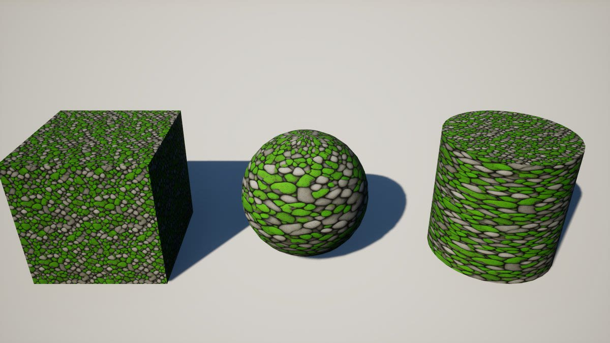

# AI Texture from Prompt

An open-weight text-to-image model, running on your GPU, driven from the Unreal Editor through UnrealPy.
Type "mossy cobblestone" and one to three seconds of GPU time later the editor has a seamless, tiling texture, a
material showing it, and that material on the actors you selected.

*`demo.py "mossy cobblestone" --seed 7`: the screenshot `ue.agent.capture_viewport` took of the demo level.*

## What it does

**Tools > UnrealPy > AI Texture from Prompt...** opens a dialog (prompt, size, steps, seed, seamless,
tiling). The result is three ordinary assets and one undoable edit:

- `/Game/AI/Textures/T_AI_<prompt>`: the generated image as a Texture2D (seamless by default, so it tiles);
- `/Game/AI/Materials/MI_AI_<prompt>`: an instance of `/Game/AI/M_AITexture` (made on first use: Albedo
  texture at TexCoord x Tiling into Base Color, plus a Roughness parameter) showing it;
- that instance on every material slot of the actors that were selected, in one transaction (Ctrl+Z undoes it).

The editor stays responsive while the GPU works: the model runs in a separate process and the editor
collects the answer on later ticks.

## Requirements

- Windows 10/11 x64 (the model environment also locks for x86-64 Linux), UE 5.8 and this project's UnrealPy
  plugin built.
- An NVIDIA GPU with 8 GB of VRAM (tested on an RTX 3070 Ti 8 GB) and a driver for CUDA 13.0 (580 or newer).
  The model never runs on the CPU.
- ~5.8 GB of disk: 3.7 GB of weights and a 2 GB torch wheel, all under the project's `Intermediate/` folder
  and the uv cache.
- [uv](https://docs.astral.sh/uv/).

## Run it (one command)

From the project folder, once the model is set up (below):

    uv run python Python/examples/ai_texture/demo.py "mossy cobblestone"

It runs the editor headless (no window) to generate the texture, make the material and dress the demo level
`/Game/AI/AITexture_Demo` (a cube, a sphere and a cylinder wearing it, sun, sky and a camera), then runs the
game offscreen on that level and saves a screenshot with `ue.agent.capture_viewport` under
`Saved/AITexture/Captures`. It prints a JSON summary: the assets, the seed, the GPU seconds and the screenshot.
Add `--seed N` to repeat an image, `--fake` to use the procedural stand-in (no model, no GPU). On the
test machine the whole run took about 4 minutes the first time (77 s in the editor, of which ~30 s loading
the model and 4.7 s generating; most of the rest is the game compiling the demo level's shaders: with them
compiled, the capture step took 22 s).

The two halves on their own:

    uv run unrealpy run --editor Python/examples/ai_texture/editor.py:main -- "mossy cobblestone"
    uv run unrealpy run --render --map /Game/AI/AITexture_Demo Python/examples/ai_texture/editor.py:capture

In an open editor, add the menu entry (or put the line in a startup script):

    uv run unrealpy editor exec "import examples.ai_texture.editor as e; e.install_menu()"

## Set up the model (downloads ~5.8 GB, once)

From the project folder, in PowerShell (keep the uv cache off C: if you like: `$env:UV_CACHE_DIR`):

    $env:UV_PROJECT_ENVIRONMENT = "$PWD\Intermediate\AITexture\venv"
    uv sync --project Python\examples\ai_texture\env --python <engine>\Engine\Binaries\ThirdParty\Python3\Win64\python.exe --no-python-downloads
    $env:PYTHONPATH = "$PWD\Python"
    $env:HF_HOME = "$PWD\Intermediate\AITexture\hf-home"
    Intermediate\AITexture\venv\Scripts\python.exe -m examples.ai_texture.worker check
    Intermediate\AITexture\venv\Scripts\python.exe -m examples.ai_texture.worker fetch --models Intermediate\AITexture\models

Use your engine's `Engine\Binaries\ThirdParty\Python3\Win64\python.exe` (any CPython 3.11 works). `check`
prints the torch build, CUDA and free VRAM without loading the model. The weights land in
`Intermediate/AITexture/models`, which git ignores: they are never committed nor staged in a package. The
model process never downloads anything (`HF_HUB_OFFLINE=1`); only `worker fetch` does.

## Model and licences

Segmind-Vega (an SDXL distilled to a 745M-parameter UNet) with the Segmind-VegaRT LCM adapter (4 steps, no
classifier-free guidance) and the fp16-safe SDXL VAE. 1024 x 1024 by default (256..1024 in steps of 64).

| Files | Repository | Licence | Size |
|---|---|---|---|
| UNet, both text encoders, tokenizers, scheduler (fp16 only) | [`segmind/Segmind-Vega`](https://huggingface.co/segmind/Segmind-Vega) | Apache-2.0 | 3,129.2 MB |
| LCM LoRA | [`segmind/Segmind-VegaRT`](https://huggingface.co/segmind/Segmind-VegaRT) | Apache-2.0 | 239.2 MB |
| VAE (fp16-safe) | [`madebyollin/sdxl-vae-fp16-fix`](https://huggingface.co/madebyollin/sdxl-vae-fp16-fix) | MIT | 334.6 MB |
| torch 2.14.1+cu130 (CUDA libraries included) | download.pytorch.org | BSD-3-Clause | 1,990.6 MB |
| diffusers, transformers, accelerate, peft, safetensors, huggingface-hub, numpy | PyPI | Apache-2.0 / BSD | ~62 MB |

All three weight repositories are public, not gated, and published under permissive licences (checked on
Hugging Face, November 2026): Apache-2.0 and MIT allow use, modification and redistribution, commercial use
included, with the licence notice kept; Apache-2.0 adds a patent grant and no use restrictions. Generated
images are yours. This example does not redistribute the weights: `worker fetch` downloads them from the
publishers. One caveat to weigh before shipping generated textures in a commercial game: Segmind describes
Vega as distilled from SDXL 1.0 (whose own licence is CreativeML Open RAIL++-M, with use-based
restrictions) and other SDXL fine-tunes, trained on datasets that include scraped images. The licence
Segmind grants is Apache-2.0; the provenance of the training data is the publisher's, not audited here.

## Performance (RTX 3070 Ti 8 GB, Windows 10)

| Offload plan | `none` | `encoders` | `model` |
|---|---|---|---|
| Chosen when free VRAM at load is | >= 7.2 GB | >= 6.0 GB | less |
| First load (from disk) | 18 s | 30 s | 23 s |
| One 1024 px image, 4 steps | 1.2-1.5 s | 2.7-3.0 s | 3.9-5.3 s |
| Peak VRAM of the model process | ~6.4 GB | ~5.3 GB | ~4.1 GB |
| RAM of the model process | ~1.8 GB | ~3.2 GB | ~4.8 GB |

`none` keeps everything on the GPU (0.55 s denoising, 0.5 s decoding; the weights go straight from disk to
VRAM); `encoders` keeps the UNet and VAE there and brings the two text encoders (1.5 GB) over from RAM for
each prompt; `model` lets every component take its turn (diffusers' model CPU offload). Force one with
`AI_TEXTURE_OFFLOAD=none|encoders|model` (or `worker serve --offload`). The margins matter on Windows:
running out of VRAM does not fail there, the driver spills into shared system memory and every image takes
30-120 s instead of one or two. The process keeps the model until it has been idle for 10 minutes (or the
editor exits), then exits and frees VRAM and RAM.

## Why a separate process and environment

The model environment (`env/pyproject.toml`, torch from the PyTorch CUDA 13.0 index) lives in
`Intermediate/AITexture/venv`, not in the project's `.venv`:

- **Packaging**: torch never enters the game's environment, so it can never ship in a packaged game.
- **The editor's exact sync**: whenever `pyproject.toml` or `uv.lock` changes, the editor runs
  `uv sync --group dev` on `.venv`, which removes every package of a group not named: an `ai` group would
  lose its 2 GB of torch each time, unless it were a default group, which would download torch on every
  developer's machine.
- **Isolation**: inference never holds the editor's GIL or game thread; a CUDA error or out-of-memory kills
  only the model process (the editor reports it and restarts it on the next request).

Generated PNGs stay in `Saved/AITexture` as the textures' import sources (Reimport works); the log is
`Intermediate/AITexture/worker.log`.

## Try it without the model

The procedural stand-in (seamless sine-noise coloured by the prompt, numpy only) runs the whole flow: tick
**Fake** in the dialog, or

    uv run python Python/examples/ai_texture/demo.py "mossy cobblestone" --fake

## Files

| File | Runs in | Does |
|---|---|---|
| `core.py` | both | asset naming, request/response lines, pixels to RGBA8, PNG encoding, procedural stand-in |
| `model.py` | model process | the file list to download, the diffusers pipeline (lazy torch import), seamless padding, offload |
| `worker.py` | model process | `serve` (stdin/stdout JSON lines), `fetch`, `check` |
| `client.py` | editor | starts the process, sends requests, collects answers on a reader thread |
| `editor.py` | editor / game | menu entry, dialog, texture import, material, assignment, demo level, `main` and `capture` |
| `demo.py` | command line | the one-command run: `editor.py:main` in the editor, then `editor.py:capture` in the game |
| `env/pyproject.toml`, `env/uv.lock` | - | the model environment |

`Tests/unit/test_ai_texture.py` covers everything that needs neither torch nor the engine, including the
real model process with the stand-in.

## Alternatives considered

- **SD-Turbo** (`stabilityai/sd-turbo`, 2,581.7 MB fp16): one step, ~0.2 s, 512 px, but under the
  Stability AI Community License (free below $1M yearly revenue, attribution and acceptable-use terms), not
  Apache/MIT.
- **Depth Anything V2 Small** (`depth-anything/Depth-Anything-V2-Small-hf`, Apache-2.0, 99.2 MB, <1 GB VRAM):
  depth from a viewport capture or from the generated texture (height/normal maps). A natural second step
  rather than the headline.
- SDXL-Turbo (non-commercial licence), Sana/Sana-Sprint (Apache weights, but a 5.2 GB Gemma-2 text encoder
  under Gemma terms that does not fit next to the editor), FLUX.1-schnell (Apache, 12B: too big for 8 GB
  with the editor open) and the other Depth Anything V2 sizes (CC-BY-NC) were ruled out.
