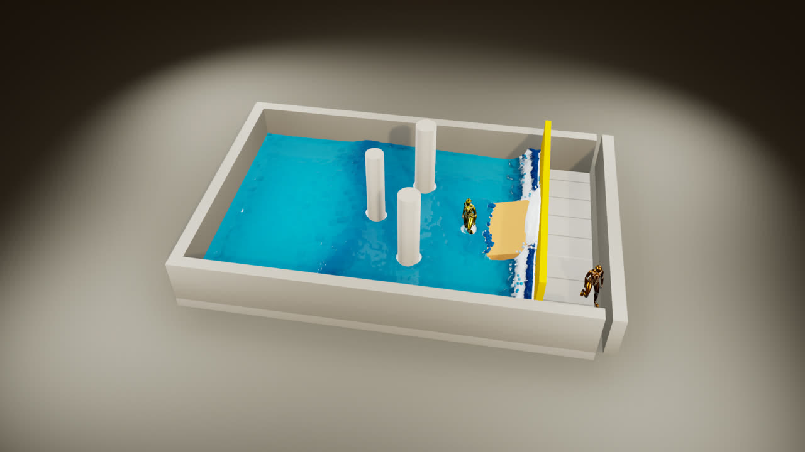

# GPU Fluid with NVIDIA Warp

A GPU fluid simulated by **Python kernels, inside the game**: about 97,000 particles of water, every step of
the simulation a Python function that NVIDIA Warp compiles to a CUDA kernel, called by gameplay code written
with UnrealPy, drawn as a water surface with foam and spray. It runs in Play In Editor and in a packaged
Development build, at 65 fps at 1920x1080 with Lumen on an RTX 3070 Ti (8 GB).



*`demo.py --packaged`: the last frame of the run, 1920x1080.*

## What it does

A concrete tank, 12 x 8 m. At one end the water stands behind a gate; in the tank are three pillars, a ramp
and seven of Epic's mannequins; at the far end a yellow wave paddle. The gate lifts, the dam breaks, the
water runs round the pillars, up the ramp and into the mannequins, and slams into the far wall; then the
paddle strokes in and out and keeps sending waves back.

The water pushes the mannequins. Every frame the game gives the kernels each mannequin's body as a capsule
(and a fallen one's pelvis), the kernels push the water out of them and add up how fast the water flows
around each one; the game shoves a mannequin with that flow, and a strong enough wave knocks it over (it
goes limp: the mannequin's own physics asset, simulated).

## The simulation (`sim.py`)

Position-based fluids (Macklin and Mueller, 2013) in NVIDIA Warp:

```python
@wp.kernel
def lambdas(grid: wp.uint64, p: wp.array[wp.vec3], lam: wp.array[float], h: float, ...):
    tid = wp.tid()
    i = wp.hash_grid_point_id(grid, tid)
    ...
    for j in wp.hash_grid_query(grid, pi, h):      # the neighbours, from a wp.HashGrid
        r = pi - p[j]
        rho += poly6(wp.dot(r, r), h, k_poly)
        ...
    lam[i] = -c / (sum_sq + wp.dot(grad_i, grad_i) + relax)
```

One frame: predict the positions under gravity, build the hash grid, then three iterations of the density
constraint (`lambdas`, `deltas`) each followed by `collide` (the tank, the moving paddle and the gate, the
pillars, the ramp as an oriented box, the mannequins' capsules), then `finish` (velocities from the moves,
wall friction, the water each capsule feels). Substeps of at most 1/60 s; the constraint only pushes apart
(no surface tension pulling the free surface into clumps), with Macklin's artificial pressure against
clustering. Particles are 7 cm apart; the smoothing radius is 14 cm. Alone on the RTX 3070 Ti a frame of
about 97,000 particles, the height field and the spray included, takes about 5 ms of GPU time.

## Getting the water on screen

The particles are never drawn one by one, and they never go through a list of Python objects:

1. kernels turn them into a **height field** on the GPU, a 240 x 160 grid over the tank (5 cm cells): per
   cell, how many particles stand in its column, the lowest and the highest one, how fast they go; smoothed
   over 5 x 5 cells into the water's depth on its floor (from the water each column holds, so a breaking
   crest does not stand up as a spike), the foam (the speed) and the surface's normal. The particles that
   fly above that surface are the **spray**: a kernel packs them (up to 16,384) at the front of a second
   array;
2. both arrays are copied, without waiting, into pinned host memory; the game reads them one frame later,
   when they have long arrived, so the game thread never waits for the kernels it has just launched;
3. UnrealPy's `FloatTextureLibrary.WriteFloatTexture` copies each NumPy array into an RGBA32F texture. The
   texels travel as `int32` (a view of the float32 array, `.view(np.int32)`), because UnrealPy turns a NumPy
   int32 array into a `TArray<int32>` with one memory copy;
4. the **surface** is one `InstancedStaticMeshComponent` of 38,400 small quads, one per cell: the material
   `M_FluidSurface` lifts each corner to the height field in the vertex shader, takes the normal from it,
   colours the water by its depth (clear and light where it is shallow, deep blue where it is deep) and
   turns it white where it is fast or steep. The **spray** is 16,384 instanced quads that `M_FluidParticle`
   moves to their texels and draws as little spheres of water. Both materials are built by `assets.py`
   with MaterialEditingLibrary, into `Content/Fluid`.

## Run it (one command)

From the project folder, install the scene and recording dependencies:

    uv sync --locked --group fluid --group media
    uv run --no-sync python Python/examples/fluid/demo.py

It builds the materials if the project lacks them, copies the mannequins from the engine's template if needed
(see `examples/mannequins.py`), starts a headless editor (no window, rendering offscreen) with Lumen, enters
Play In Editor with `FluidMode`, shoots the clip frame by frame, then measures the frame rate for a few
seconds of real time. ffmpeg (from the `imageio-ffmpeg` wheel) makes `Saved/Fluid/fluid_pie.mp4`: a 3 s card
with the `lambdas` kernel's source, then the clip with a one-line banner, and a JPEG of the last frame. The
packaged game runs the same scenario at 1920x1080:

    unrealpy package --group fluid
    uv run --no-sync python Python/examples/fluid/demo.py --packaged

## Packaging

Warp is the `fluid` dependency group: `warp-lang` 1.19.0, Apache-2.0 (the licence in the installed
package's metadata). It brings its own CUDA compiler (NVRTC, inside `warp.dll`) and needs only the NVIDIA
driver at run time: no CUDA toolkit. Warp adds about 330 MB to the package.

A packaged game stages the project's Python as bytecode, and Warp builds its kernels from their Python
source (`inspect`), so `sim.py` ships as source: in `Config/DefaultUnrealPy.ini`,

    [/Script/UnrealPyCore.UnrealPySettings]
    +StageSource=examples/fluid/sim.py

The game sets Warp's kernel cache to its own `Saved/WarpCache`: the first run compiles the kernels (a few
seconds), later runs load them.

## Files

| File | Runs in | Does |
|---|---|---|
| `sim.py` | game, tests (CPU device) | the Warp kernels (simulation, height field, spray) and the `Fluid` that runs them; the tank |
| `game.py` | game | `FluidMode`, the tank's actors, the mannequins, the surface and spray instances, `pie`/`demo`/`play` |
| `assets.py` | editor | builds `M_FluidSurface` and `M_FluidParticle` |
| `demo.py` | command line | the one-command run and the MP4/JPEG |

`Tests/unit/test_fluid.py` runs the kernels on Warp's CPU device: a small dam breaks and stays in its tank,
nothing gets inside the pillar or a capsule, the texels and the capsules' water come back right.

## Licences

| Package | Licence |
|---|---|
| `warp-lang` 1.19.0 | Apache-2.0 |
| UE5 mannequins (engine template content) | Unreal Engine EULA: usable in Unreal Engine projects; not redistributed by this repository |
