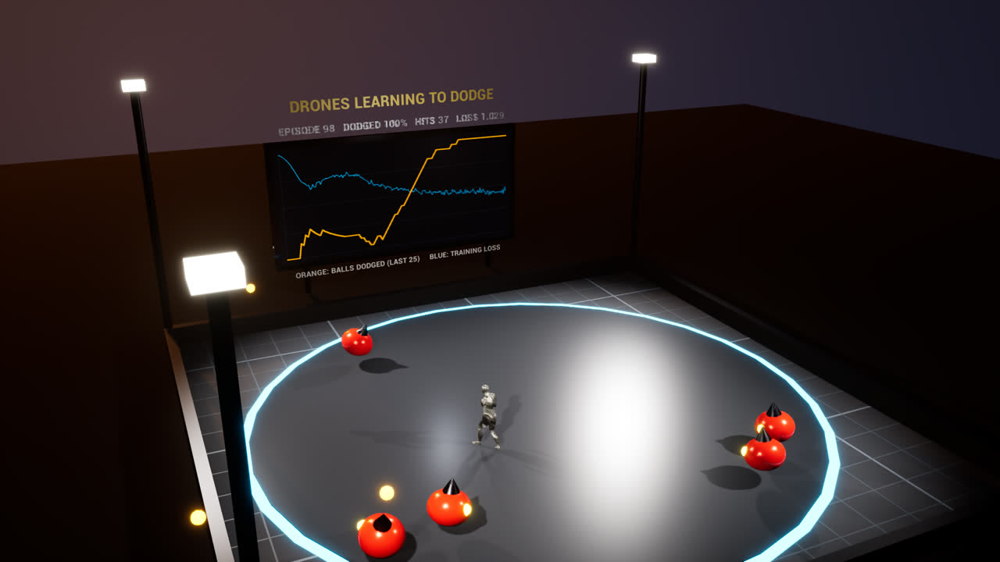

# Enemies That Learn While You Play

PyTorch **training inside the game**, in gameplay code written with UnrealPy. The network is born when the
game mode starts, drives the enemies from the first second and learns from what happens to them, in Play
In Editor and in a packaged Development build.

*`demo.py --packaged`: the last frame of the run, 1920x1080.*

## What it does

The hero (an autopilot: Epic's mannequin, see below) walks a circle round the middle of the arena and
throws a ball at one of five drones every 0.45 s, leading the target. One ball is one **episode**: dodged or
hit.

- **The policy**: an MLP (11 inputs, two hidden layers of 64, 9 moves: stay or one of 8 directions in the
  drone's own frame) drives every drone, ten decisions a second. It starts untrained: its output layer is
  zero with a nudge towards "stay", so at first the drones hover and get hit.
- **The teacher**: a scripted expert looks at the same 11 numbers (distance to the hero; the most urgent
  ball's position, velocity, miss offset and time to arrival; the drone's place in the arena) and says
  which move it would make: step away from where the ball will pass, otherwise keep a distance band around
  the hero and circle it, never leave the arena.
- **Smooth motion**: the policy picks a target velocity ten times a second; every frame the drone's
  velocity moves towards it at a bounded acceleration (26 m/s^2), its heading turns at a bounded rate,
  and it banks into turns and tilts into accelerations (`arena.steer`), so nothing snaps between
  decisions. The drones still learn with it (the expert reacts earlier; the curve below is with it).
- **Learning is DAgger** (dataset aggregation): the policy always acts, the expert only labels the
  situations the policy actually gets into, and the policy trains on those labels (cross-entropy, Adam,
  batches of 128 with half of them from moments with a ball in the air), four times a second. Supervised,
  so robust; on-policy, so the drones learn to recover from their own mistakes.
- **The board** behind the arena plots the dodge rate over the last 25 episodes (orange) and the training
  loss (blue), with the episode count, hits and loss in text. The chart is drawn with numpy, encoded as a
  PNG with `zlib` and turned into a texture (`ImportBufferAsTexture2D`).

In the recorded runs the dodge rate stays low for the first ~20 s of game time, climbs between 20 and
40 s, and holds near or above 90 % after that: the same in Play In Editor and in the packaged game.

## The mannequin

The hero is Epic's UE5 mannequin with the third-person template's anim blueprint: a `DemoMannequin`
(`examples/characters.py`) is an `ACharacter` that CharacterMovement moves and the anim blueprint animates.
It walks at 300 cm/s, the walk animation's own ground speed (measured from the feet), so the feet do not
slide, and turns at a limited rate; the rules throw from where the character really is. The repository
ships no Unreal assets: `examples/mannequins.py` copies the mannequin pack from the engine's own template
content to the project's `Content/Characters/Mannequins` the first time a demo runs (or with
`uv run python -m examples.mannequins`); `Config/DefaultGame.ini` cooks that folder.

## Look

Lumen global illumination and reflections (the project's renderer settings turn on the mesh distance
fields it traces), sky
atmosphere, a low sun behind the board, a sky light with real-time capture, height fog, four floodlight
masts; glossy drones with glowing eyes, glowing balls, a cyan ring of light round the arena, metal walls, a
grid floor, all from engine materials' parameters (`examples/stage.py`); a post-process volume with
auto-exposure clamped to one value, no motion blur, film grain or chromatic aberration, a light vignette.
The clip and screenshots are the player's view through a camera: in a game (and the packaged build)
shot with `HighResShot` at 1920x1080; in Play In Editor captured from the editor viewport at its own
size (1274x682 in the headless editor), because `HighResShot` stops the play world from ticking there.

## Run it (one command)

From the project folder, with the project environment synced (`uv sync --group dev`, which includes the
`learning` group):

    uv run python Python/examples/learning_enemies/demo.py

It copies the mannequins on first run, starts a headless editor (no window, rendering offscreen) with
Lumen, enters **Play In Editor** with `LearningMode`, and shoots the clip from the first second: 15 s at 30 fps as a 3x time-lapse
(the game steps exactly 0.1 s per frame), so it shows the first 45 s of learning.  ffmpeg (from the `imageio-ffmpeg` wheel, fetched by
uv on demand, nothing added to the project) makes `Saved/LearningEnemies/learning_enemies_pie.mp4` and a
JPEG of the last frame. `--speed 1` records in real time.

The packaged game (see below) runs the same scenario:

    uv run python Python/examples/learning_enemies/demo.py --packaged

To watch it in a window:

    UnrealEditor.exe UnrealPyExamples.uproject -game -windowed -ResX=1600 -ResY=900 -UnrealPyRun=examples.learning_enemies.game:play -UnrealPyKeepAlive

## Keeping it at 60 fps

The game thread only steps the rules (the policy's forward pass included) and moves actors; training and
drawing the chart run in worker threads (PyTorch and zlib release the GIL), with two copies of the network
so an action never sees half-updated weights. It runs at 60 fps, in Play In Editor and packaged.

While a clip is recorded, each frame waits for the training it asked for (`Arena.catch_up`): a 1080p shot
takes longer than its 0.1 s of game time, and without the wait the drones would learn per wall-clock second
instead of per game second. Played in real time, nothing waits.

## Packaging

PyTorch is the `learning` dependency group of the project's `pyproject.toml`: the CPU build of torch
2.14.1 from the PyTorch CPU index (no CUDA libraries), locked in `uv.lock` and included in `dev` so the
editor's environment has it. A packaged game installs it with

    uv run unrealpy package --group learning

It works: the packaged Development build runs the same scenario (`demo.py --packaged`), learning curve,
clip and screenshot included, with the same timeline as in the editor.

Size: torch adds 450 MB to the package and its dependencies 35 MB (sympy 25, networkx 7, the rest small);
81 MB of that are torch's C++ headers and import libraries, which a game never uses and a `StageExclude`
entry could drop. The packaged build that ran all three runtime examples is 1.8 GB (see the security
camera's README for the command).

## Files

| File | Runs in | Does |
|---|---|---|
| `brain.py` | game, tests | perception, the scripted expert, the MLP, the DAgger learner, the background trainer, the scoreboard |
| `arena.py` | game, tests | the rules: hero, throws, flights, hits, drones' moves, when to decide and train |
| `chart.py` | game (worker thread), tests | the learning curve as a picture, PNG encoding |
| `game.py` | game | `LearningMode`, `LearningDrone`, `LearningHero`, the arena and board, `pie`/`demo`/`play` |
| `demo.py` | command line | the one-command run and the MP4/JPEG |

`Tests/unit/test_learning_enemies.py` covers everything that needs no engine, including a full minute of
the arena: the drones must go from mostly hit to mostly dodging.

## Licences

| Package | Licence |
|---|---|
| `torch` 2.14.1+cpu (PyTorch) | BSD-3-Clause |
| `sympy`, `networkx`, `fsspec`, `mpmath` (torch's dependencies) | BSD-3-Clause |
| `filelock`, `setuptools` (torch's dependencies) | Unlicense, MIT |
| `imageio-ffmpeg` 0.6.0 (only to encode the clip, never in the game) | BSD-2-Clause; its ffmpeg binary is GPL-3.0 |

No pretrained weights: the network is created and trained in the game.
