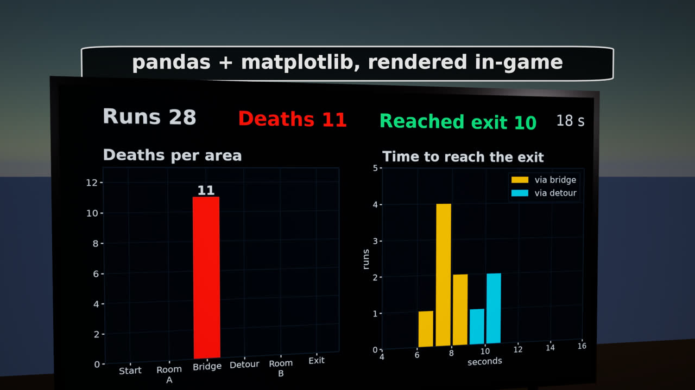

# Live Playtest Analytics

pandas, NumPy and matplotlib **inside the game**, in gameplay code written with UnrealPy: what game teams
use telemetry for during playtests (where do players go, where do they die, how long does the level take),
collected while the level is played and shown live, in the world. Not an editor tool, not an export for
later: it runs in Play In Editor and in a packaged Development build.

*`demo.py --packaged`: the last frame of the run, 1920x1080.*

## What it does

A small greybox level (`level.py`): a start room, a hall, Room A, a narrow **bridge over a pit** with a
swinging blade across its middle, Room B, a hall and the exit; and an alternative route, a longer **detour**
from Room A round to Room B with a spike trap in it. Low walls with doorways, platforms over a dark void.

Ten autopiloted playtesters (Epic's mannequins) come in three waves and try to reach the exit
(`playtest.py`). Each run picks a route, most of them the short way over the bridge, the rest the detour;
everyone slows down on the bridge. The blade knocks whoever it catches off the bridge (a ragdoll flung into
the pit); the spikes now and then catch someone in the detour. Whoever dies or reaches the exit starts
another run, so the session keeps producing data. An `AnalyticsMode` written in Python logs telemetry as
they play: every tester's position five times a second, and every start, death (with its cause) and
finish.

It shows it in the world, building up from nothing:

- **where playtesters walk**, on the floor: NumPy `histogram2d` of the positions over the level, a
  separable Gaussian blur, a cyan colour map with alpha rising with the traffic, on a translucent plane just
  above the floors. The popular route lights up; the detour stays faint;
- **where they die**: a red cross on the floor at every death, and the deaths' own heatmap in red over the
  traffic, piling up on the bridge;
- **a screen with two big charts** (matplotlib, redrawn twice a second and at once on every death): deaths
  per area of the level (pandas; the bridge's bar in red towers over the rest) and the time the runs that
  reach the exit take, a histogram stacked by route (pandas `merge` of each finish with its start); over
  them the totals: runs, deaths, runs that reached the exit.

Big captions say what each display is ("Where playtesters walk (NumPy heatmap)", "Where they die", "pandas
+ matplotlib, rendered in-game"); they and the charts are drawn by matplotlib in the render process and
shown on unlit planes, so they stay readable in any light.

The clip is 15 s (after 3 s of play, so the first wave is on its way): wide on the whole level for 4 s, a
move to the bridge and the blade, then on to the screen (a `CameraPath` of eased keyframes, no cuts), with
a one-line banner on top: "Live playtest analytics: pandas + matplotlib + NumPy inside the game".

## Keeping the game at 60 fps

The game thread only appends rows to lists (a few microseconds) and swaps two textures twice a second.
Twice a second a snapshot of the logs goes to **a separate Python process**, which builds the DataFrames and
the two heatmaps and draws the charts, and sends back two image files.
matplotlib is pure Python for much of its work: in a thread of the game it would hold the game's GIL for
about a quarter of a second per dashboard. The process is the engine's own interpreter (`pythonw`, so no
console window) started by `multiprocessing` in spawn mode, which hands it the game's `sys.path`.

It runs at 60 fps, in Play In Editor and packaged; one render in the analytics process takes about 0.2 s.

## Run it (one command)

From the project folder, with the project environment synced (`uv sync --group dev`, which includes the
`analytics` group):

    uv run python Python/examples/live_analytics/demo.py

It copies the mannequins from the engine's template on first run (see below), starts a headless editor
(no window, rendering offscreen) with Lumen, enters **Play In Editor** with `AnalyticsMode` and shoots the
15 s clip described above. ffmpeg (from the `imageio-ffmpeg` wheel,
fetched by uv on demand) makes `Saved/LiveAnalytics/live_analytics_pie.mp4`, with the banner, and a JPEG of
the last frame. The packaged game runs the same scenario at 1920x1080:

    uv run python Python/examples/live_analytics/demo.py --packaged

## The mannequins

The playtesters are Epic's UE5 mannequins (Manny and Quinn) with the third-person template's anim blueprint: a
`DemoMannequin` (`examples/characters.py`) is an `ACharacter` that CharacterMovement moves and the anim
blueprint animates (idle, walk, jog blended by speed). The blend space's samples are the animations' own
ground speeds (walk 300 cm/s, jog 600 cm/s, measured from the feet), and the testers move between those
speeds, so the feet do not slide; they turn at a limited rate towards where they go. A dead tester goes
limp: the mannequin's own physics asset, simulated. The repository ships
no Unreal assets: `examples/mannequins.py` copies the mannequin pack from the engine's own template content
(`Templates/TemplateResources/High/Characters/Content/Mannequins`, 125 MB) to the project's
`Content/Characters/Mannequins`, the paths the template uses, the first time a demo runs (or with
`uv run python -m examples.mannequins`). `Config/DefaultGame.ini` cooks that folder.

## Look

Lumen global illumination and reflections (the demo starts the engine with
`-ini:Engine:[/Script/Engine.RendererSettings]:r.GenerateMeshDistanceFields=True`, which Lumen's software
tracing needs, for that run only), sky atmosphere, sun, sky light with real-time capture, height fog,
floodlights; physically based materials (greybox walls, metal-paint mannequins, grid floors, a metal
bridge and blade) and emissive hazard stripes, crosses and rings, all from engine materials' parameters
(`examples/stage.py`); a post-process
volume with auto-exposure clamped to one value (no pumping), no motion blur, film grain or chromatic
aberration, a light vignette. The clip and screenshots are the player's view through a camera: in a game (and the packaged build)
shot with `HighResShot` at 1920x1080; in Play In Editor captured from the editor viewport at its own
size (1274x682 in the headless editor), because `HighResShot` stops the play world from ticking there.

## Packaging

pandas and matplotlib are the `analytics` dependency group of the project's `pyproject.toml` (locked in
`uv.lock`), included in `dev` so the editor's environment has it. A packaged game installs it with

    uv run unrealpy package --group analytics

It works: the packaged Development build runs the same scenario (`demo.py --packaged`), the render process
included (the packaged game stages the engine's `pythonw`). pandas, matplotlib and their dependencies add
about 80 MB to the package (pandas 37, matplotlib 21, Pillow 14, fontTools 6, the rest small; NumPy is
already there). The packaged build that ran all three runtime examples is 1.8 GB (see the security
camera's README for the command).

## Files

| File | Runs in | Does |
|---|---|---|
| `level.py` | game, tests | the level: rooms, halls, bridge, detour, walls, routes, hazards, areas |
| `playtest.py` | game, tests | the session: waves, routes, the blade and the spikes, deaths, finishes, retries |
| `telemetry.py` | game (appends), render process, tests | the logs; deaths per area, finish times, totals, heatmaps (pandas, NumPy) |
| `charts.py` | render process, tests | the dashboard and the floor overlay (matplotlib) |
| `render.py` | render process, tests | one call that makes everything the displays need |
| `game.py` | game | `AnalyticsMode`, `PlaytestTester`, the level's actors, the displays, `pie`/`demo`/`play` |
| `demo.py` | command line | the one-command run and the MP4/JPEG |

`Tests/unit/test_live_analytics.py` covers the level, the session's rules, every summary, the pictures and
the renderer.

## Licences

| Package | Licence |
|---|---|
| `pandas` 3.1.1 | BSD-3-Clause |
| `matplotlib` 3.11.2 | PSF-style matplotlib licence (permissive) |
| their dependencies (`contourpy`, `cycler`, `fonttools`, `kiwisolver`, `pillow`, `pyparsing`, `python-dateutil`, `tzdata`) | BSD / MIT / Apache-2.0 / HPND |
| UE5 mannequins (engine template content) | Unreal Engine EULA: usable in Unreal Engine projects; not redistributed by this repository |
