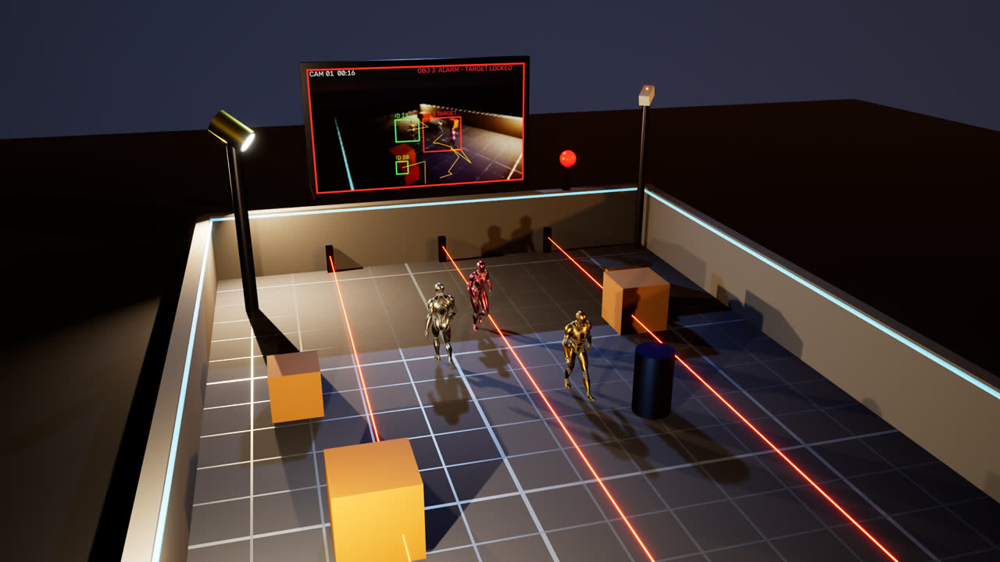

# Security Camera with Vision

OpenCV running **inside the game**, in gameplay code written with UnrealPy. Not an editor tool: the game
mode, the actors and the vision pipeline are Python classes that run in Play In Editor and in a packaged
Development build.

*`demo.py --packaged`: the last frame of the run, 1920x1080.*

## What it does

A camera on a post watches a room where two guards walk their rounds and an intruder jogs through (Epic's
mannequins, see below). The camera is a `SceneCaptureComponent2D` rendering into a 256x144 render target; eight
times a second the game reads its pixels and runs OpenCV on them:

- **MOG2 background subtraction**, an opening and a dilation, **contours**, boxes (body and head merged);
- a small **tracker** that keeps an id per object from frame to frame and picks the target (the longest
  tracked);
- the target's feet, back-projected through the camera model onto the floor, become a world position.

The gameplay reacts:

- a **spotlight turret** swings onto the target (and sweeps the room when it is clear), its beam visible
  in volumetric fog;
- an **alarm beacon** turns from green to flashing red while something is tracked (and for 1.5 s after),
  and the **laser tripwires** across the room flash with it;
- a **monitor** on the wall shows the camera feed with OpenCV's boxes, ids, trails and status drawn on it:
  the annotated frame is encoded as a JPEG and turned back into a texture
  (`KismetRenderingLibrary.ImportBufferAsTexture2D`) on an unlit screen material.

The camera does not see the lights the game moves (its show flags turn spot and point lights off) nor the
monitor, the beacon or the lasers, so the spotlight sweeping and the screens and lights changing never look
like motion.

## The mannequins

The people are Epic's UE5 mannequins (Manny and Quinn) with the third-person template's anim blueprint: a
`DemoMannequin` (`examples/characters.py`) is an `ACharacter` that CharacterMovement moves and the anim
blueprint animates (idle, walk, jog blended by speed). The blend space's samples are the animations' own
ground speeds (walk 300 cm/s, jog 600 cm/s, measured from the feet): the guards walk at 300, the intruder
jogs at 450, and the feet do not slide; they turn at a limited rate and stop into idle. Their metal paint is
the mannequin material's own parameters (silver, gold, magenta). The repository ships no Unreal assets:
`examples/mannequins.py` copies the mannequin pack from the engine's own template content
(`Templates/TemplateResources/High/Characters/Content/Mannequins`, 125 MB) to the project's
`Content/Characters/Mannequins`, the paths the template uses, the first time a demo runs (or with
`uv run --no-sync python -m examples.mannequins`). `Config/DefaultGame.ini` cooks that folder.

## Look

Lumen global illumination and reflections (the project's renderer settings turn on the mesh distance
fields Lumen's software tracing needs), sky atmosphere, a low warm sun, a sky light with real-time capture,
volumetric height fog (the searchlight's beam), two warm panel lights and a cool rim light; physically based
materials (pale concrete, wood, metal, a grid floor) and emissive lasers, light strips, beacon and lenses,
all from engine materials' parameters (`examples/stage.py`); a post-process volume with auto-exposure
clamped to one value (no pumping), no motion blur, film grain or chromatic aberration, a light vignette.
The clip and screenshots are the player's view through a camera: in a game (and the packaged build)
shot with `HighResShot` at 1920x1080; in Play In Editor captured from the editor viewport at its own
size (1274x682 in the headless editor), because `HighResShot` stops the play world from ticking there.

## Run it (one command)

From the project folder, install the scene and recording dependencies:

    uv sync --locked --group vision --group media
    uv run --no-sync python Python/examples/security_camera/demo.py

It copies the mannequins on first run, starts a headless editor (no window, rendering offscreen) with
Lumen, enters **Play In Editor** with `SecurityMode`, lets it run a few seconds, then shoots a 12 s clip (the game steps exactly 1/30 s per
frame, so the clip plays at real speed). ffmpeg (from the
`imageio-ffmpeg` wheel, fetched by uv on demand, nothing added to the project) makes
`Saved/SecurityCamera/security_camera_pie.mp4` and a JPEG of the last frame. It prints a JSON summary.

The packaged game (see below) runs the same scenario:

    uv run --no-sync python Python/examples/security_camera/demo.py --packaged

Watch it in a window (WASD and the mouse fly the spectator):

    UnrealEditor.exe UnrealPyExamples.uproject -game -windowed -ResX=1600 -ResY=900 -UnrealPyRun=examples.security_camera.game:play -UnrealPyKeepAlive

## Keeping it at 60 fps

The vision is a small pipeline spread over frames, so no frame pays for all of it:

1. `capture_scene()` on the camera (rendered with the frame);
2. next frame, read the render target back (`ExportRenderTarget` to a PNG, `cv2.imread`) and hand it to a
   worker thread (OpenCV releases the GIL while it works);
3. when the worker answers: aim the turret, set the beacon, put the picture on the monitor.

It runs at 60 fps, in Play In Editor and packaged.

The read-back is the expensive step: it waits for the GPU (the game waits two frames after the capture
before reading it, so the capture itself is done). Reading the render target as an array of
`FColor` structs (`ReadRenderTarget`) costs more than 100 ms in Python for 256x144 pixels, because every
pixel becomes an object; the PNG round trip through `ExportRenderTarget` is the fastest path the engine
exposes to scripts today.

## Packaging

OpenCV is the `vision` dependency group of the project's `pyproject.toml` (`opencv-python-headless`,
locked in `uv.lock`). A packaged game installs it with

    unrealpy package --group vision

It works: the packaged Development build runs the same scenario (`demo.py --packaged`), clip and
screenshot included. On Windows, OpenCV's extension is built for the stable ABI and links `python3.dll`, which a
packaged game keeps in the engine's Python folder rather than beside its executable; UnrealPy adds that folder to
the DLL search path when it activates the environment, so the official wheel loads unchanged. On Linux the wheel
needs nothing extra.

Size: OpenCV adds 126 MB to the package, made with `unrealpy package --group vision`.

## Files

| File | Runs in | Does |
|---|---|---|
| `vision.py` | game (worker thread), tests | MOG2 detection, boxes, tracker, camera model, monitor picture, the pipeline |
| `game.py` | game | `SecurityMode`, `SecurityWalker`, `SpotlightTurret`, `AlarmBeacon`, the room, `pie`/`demo`/`play` |
| `demo.py` | command line | the one-command run and the MP4/JPEG |
| `../stage.py` | game | shared: props and materials, lights and look, screens, the film camera, starting a game mode |
| `../characters.py`, `../mannequins.py` | game; command line | shared: the mannequin character; copying the mannequin pack |
| `../showreel.py` | anywhere | shared: frame-time statistics, `unrealpy run`, ffmpeg |

`Tests/unit/test_security_camera.py` covers everything that needs no engine: detection on synthetic frames,
tracking, the camera geometry (projection and back-projection), the annotated picture, the pipeline's alarm
and target, and the shared helpers.

## Licences

| Package | Licence |
|---|---|
| `opencv-python-headless` 5.1.0.95 (OpenCV) | Apache-2.0; the wheel also bundles FFmpeg (LGPL-2.1) and other libraries under their own permissive licences |
| `imageio-ffmpeg` 0.6.0 (only to encode the clip, never in the game) | BSD-2-Clause; its ffmpeg binary is GPL-3.0 |

The scene uses `/Engine` content (basic shapes and engine materials) and the template mannequins (Unreal
Engine EULA: usable in Unreal Engine projects; copied from the engine, not redistributed by this
repository); everything else is made in Python at runtime.
