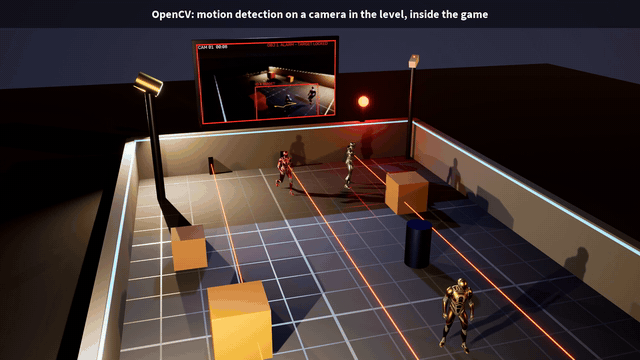

# UnrealPy examples

The Python ecosystem inside Unreal Engine games: runtime examples for [UnrealPy](https://github.com/canestudios),
the Python scripting plugin for Unreal Engine 5. Every example is gameplay code written in Python that uses a
well-known Python package **while the game runs**, in Play In Editor and in a packaged build.

| Example | Python package | What it does |
|---|---|---|
| [Security camera](Python/examples/security_camera/README.md) | OpenCV | A camera in the level watches the room through OpenCV: motion detection, tracking, an alarm |
| [Enemies that learn](Python/examples/learning_enemies/README.md) | PyTorch | Drones trained by a small network while you play: within a minute they dodge |
| [Live playtest analytics](Python/examples/live_analytics/README.md) | pandas + matplotlib + NumPy | Autopiloted playtesters run a level; heatmaps and charts show where they walk and die |
| [GPU fluid](Python/examples/fluid/README.md) | NVIDIA Warp | A fluid simulated by Python GPU kernels, pushing mannequins around a tank |

| OpenCV | PyTorch |
|---|---|
|  |  |
| **pandas + matplotlib** | **NVIDIA Warp** |
|  |  |

Each clip is the packaged Development build at 1920x1080, recorded by the example's own `demo.py`.

For a complete game written with UnrealPy, see [unrealpy-freedoom](https://github.com/canestudios/unrealpy-freedoom).

## Set up a project

1. **The plugin.** Put the UnrealPy plugin in your project's `Plugins/UnrealPy` folder (from Fab, or a
   release zip), open the project once, and create its Python environment:

       uvx --from ./Plugins/UnrealPy/Tools/unrealpy_cli unrealpy env

   (`uv` from [astral.sh/uv](https://docs.astral.sh/uv/)). This makes `.venv` with the engine's own Python
   3.11 and a `pyproject.toml` for the project.

2. **The examples.** Copy this repository's `Python/examples` folder into your project's `Python` folder,
   and tell UnrealPy to load the examples' classes at startup, in `Config/DefaultUnrealPy.ini`:

       [/Script/UnrealPyCore.UnrealPySettings]
       +ClassPackages=examples
       ; the fluid's kernels: NVIDIA Warp reads their source, so a packaged game ships it as source
       +StageSource=examples/fluid/sim.py

3. **The packages, per example.** Each example needs only its own packages. Add them to your project's
   `pyproject.toml` as a dependency group of the same name (copy it from this repository's
   [`pyproject.toml`](pyproject.toml)), then sync:

   | Example | Group | Packages |
   |---|---|---|
   | security_camera | `vision` | `opencv-python-headless` |
   | learning_enemies | `learning` | `torch` (the CPU build, from the PyTorch index: copy `[tool.uv.sources]` and `[[tool.uv.index]]` too) |
   | live_analytics | `analytics` | `pandas`, `matplotlib` |
   | fluid | `fluid` | `warp-lang` |

       uv sync --group vision                 # for example

   The demo scripts also use `matplotlib` outside the engine for their title cards, and ffmpeg from the
   `imageio-ffmpeg` wheel (fetched by uv on demand).

4. **Assets.** No example ships Unreal assets. The characters are Epic's mannequins, copied from the engine's
   own third-person template the first time a demo runs (`Python/examples/mannequins.py`); add their folder
   to the cooked directories for packaged builds, in `Config/DefaultGame.ini`:

       [/Script/UnrealEd.ProjectPackagingSettings]
       +DirectoriesToAlwaysCook=(Path="/Game/Characters/Mannequins")
       +DirectoriesToAlwaysCook=(Path="/Game/Fluid")

   The fluid's particle material is built by a script (`Python/examples/fluid/assets.py`) into
   `Content/Fluid`.

## Run an example

Each example has one command that plays it in a headless editor (no window) and saves a clip and a
screenshot, run from the project folder:

    uv run python Python/examples/security_camera/demo.py
    uv run python Python/examples/learning_enemies/demo.py
    uv run python Python/examples/live_analytics/demo.py
    uv run python Python/examples/fluid/demo.py

and the same in a packaged Development build, after packaging with the example's group:

    uv run unrealpy package --group vision
    uv run python Python/examples/security_camera/demo.py --packaged

To play one yourself, open the editor, and in the Python console (or any Python script) run the example's
`play` function, e.g. `examples.security_camera.game.play([])`; it reopens the level with the example's game
mode.

## Tests

The examples' engine-free parts (the rules, the summaries, the kernels on Warp's CPU device, the pictures)
have unit tests, which run on UnrealPy's engine-less fake of the `ue` module:

    uv sync --group dev --group vision --group learning --group analytics --group fluid
    set UNREALPY_PLUGIN=<your project>\Plugins\UnrealPy
    uv run pytest

The fake needs the type database `unrealpy stubs` writes into that project's `Intermediate/PythonStubs`
(or point `UNREALPY_TYPES` at it).

## Licences

The examples are code; the packages they use keep their own licences:

| Package | Licence | Used by |
|---|---|---|
| NumPy | BSD-3-Clause | all |
| `opencv-python-headless` (OpenCV) | Apache-2.0 (the wheel bundles FFmpeg, LGPL-2.1) | security_camera |
| PyTorch (`torch`) | BSD-3-Clause | learning_enemies |
| pandas | BSD-3-Clause | live_analytics |
| matplotlib | matplotlib licence (PSF-style, permissive) | live_analytics, the demo scripts |
| NVIDIA Warp (`warp-lang`) | Apache-2.0 | fluid |
| `imageio-ffmpeg` (ffmpeg binary, demo scripts only) | BSD-2-Clause (wrapper); ffmpeg LGPL/GPL build | the demo scripts |
| UE5 mannequins (engine template content) | Unreal Engine EULA: usable in Unreal Engine projects; not redistributed here | all |
