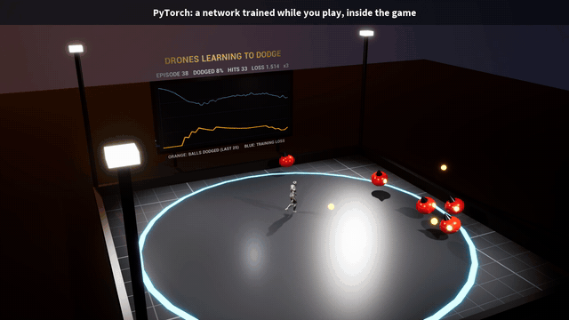
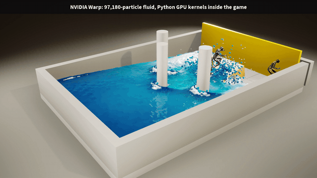

# UnrealPy examples

The Python ecosystem inside Unreal Engine games: runtime examples for [UnrealPy](https://github.com/canestudios),
the Python scripting plugin for Unreal Engine 5. Every example is gameplay code written in Python that uses a
well-known Python package **while the game runs**, in Play In Editor and in a packaged build.

| Example | Python package | What it does |
|---|---|---|
| [Security camera](Python/examples/security_camera/README.md) | OpenCV | A camera in the level watches the room through OpenCV: motion detection, tracking, an alarm |
| [Enemies that learn](Python/examples/learning_enemies/README.md) | PyTorch | Drones trained by a small network while you play: within a minute they dodge |
| [Live playtest analytics](Python/examples/live_analytics/README.md) | pandas + matplotlib + NumPy | Autopiloted playtesters run a level; heatmaps and charts show where they walk and die |
| [GPU fluid](Python/examples/fluid/README.md) | NVIDIA Warp | A fluid simulated by Python GPU kernels, pushing mannequins around a tank |

| OpenCV | PyTorch |
|---|---|
|  |  |
| **pandas + matplotlib** | **NVIDIA Warp** |
|  |  |

Each clip is the packaged Development build at 1920x1080, recorded by the example's own `demo.py`.

For a complete game written with UnrealPy, see [unrealpy-freedoom](https://github.com/canestudios/unrealpy-freedoom).

## Requirements

- Unreal Engine 5.8 (Windows), an NVIDIA GPU for the fluid.
- The **UnrealPy** plugin and its companion **ScriptCore**, distributed separately: they are not part of this
  repository (see [Plugins/README.md](Plugins/README.md)).
- [uv](https://docs.astral.sh/uv/).

## Set up

1. Clone this repository; it is an Unreal project, `UnrealPyExamples.uproject`.
2. Copy the plugins into `Plugins/`: `Plugins/UnrealPy` and `Plugins/ScriptCore`.
3. Open `UnrealPyExamples.uproject` once. On that first start UnrealPy creates the project's Python
   environment (`.venv`, with the engine's own Python, from `pyproject.toml` and `uv.lock`; it needs internet
   once) and the `ue` type stubs.
4. Install the packages of the example you want, one dependency group each (so nobody downloads them all):

   | Example | Group | Packages |
   |---|---|---|
   | security_camera | `vision` | `opencv-python-headless` |
   | learning_enemies | `learning` | `torch` (the CPU build, from the PyTorch index) |
   | live_analytics | `analytics` | `pandas`, `matplotlib` |
   | fluid | `fluid` | `warp-lang` |

       uv sync --group dev --group vision     # several groups at once work too

   The editor keeps them: it syncs the environment again only when `pyproject.toml` or `uv.lock` change (then
   run this again).

The project's configuration does the rest: `Config/DefaultUnrealPy.ini` loads the examples' classes
(`+ClassPackages=examples`) and ships the fluid's kernels as source (Warp reads them); `Config/DefaultEngine.ini`
turns on Lumen and the mesh distance fields it traces; `Config/DefaultGame.ini` cooks the folders the examples
fill at their first run: Epic's mannequins, copied from the engine's own third-person template
(`Python/examples/mannequins.py`; the repository ships no Unreal assets), and the fluid's materials
(`Python/examples/fluid/assets.py`).

## Run an example

**Play it.** Open the project, then in the editor's Python console run the example's `play` function; it
reopens the level with the example's game mode, and the example starts by itself:

    import examples.fluid.game; examples.fluid.game.play([])

(`examples.security_camera.game`, `examples.learning_enemies.game`, `examples.live_analytics.game`,
`examples.fluid.game`). The fluid needs its materials once: `uv run python Python/examples/fluid/demo.py`
builds them, or run `examples.fluid.assets.main([])` in the editor.

**Record it.** Each example has one command that plays it in a headless editor (no window) and saves a clip and
a screenshot under `Saved/`, from the project folder:

    uv run python Python/examples/security_camera/demo.py
    uv run python Python/examples/learning_enemies/demo.py
    uv run python Python/examples/live_analytics/demo.py
    uv run python Python/examples/fluid/demo.py

and the same in a packaged Development build, after packaging with the example's group:

    uvx --from ./Plugins/UnrealPy/Tools/unrealpy_cli unrealpy package --group vision
    uv run python Python/examples/security_camera/demo.py --packaged

The commands find the plugin's `unrealpy` command line in `Plugins/UnrealPy/Tools/unrealpy_cli` (through
`uvx`) when the environment does not have it. The demo scripts draw their title cards with `matplotlib`
(`uv sync --group media`) and encode with ffmpeg from the `imageio-ffmpeg` wheel, which uv fetches on demand.

## Tests

The examples' engine-free parts (the rules, the summaries, the kernels on Warp's CPU device, the pictures)
have unit tests, which run on UnrealPy's engine-less fake of the `ue` module (from `Plugins/UnrealPy`, with the
type stubs the editor wrote at its first start):

    uv sync --group dev --group vision --group learning --group analytics --group fluid
    uv run pytest

## Licences

The examples are code; the packages they use keep their own licences:

| Package | Licence | Used by |
|---|---|---|
| NumPy | BSD-3-Clause | all |
| `opencv-python-headless` (OpenCV) | Apache-2.0 (the wheel bundles FFmpeg, LGPL-2.1) | security_camera |
| PyTorch (`torch`) | BSD-3-Clause | learning_enemies |
| pandas | BSD-3-Clause | live_analytics |
| matplotlib | matplotlib licence (PSF-style, permissive) | live_analytics, the demo scripts |
| NVIDIA Warp (`warp-lang`) | Apache-2.0 | fluid |
| `imageio-ffmpeg` (ffmpeg binary, demo scripts only) | BSD-2-Clause (wrapper); ffmpeg LGPL/GPL build | the demo scripts |
| UE5 mannequins (engine template content) | Unreal Engine EULA: usable in Unreal Engine projects; not redistributed here | all |
