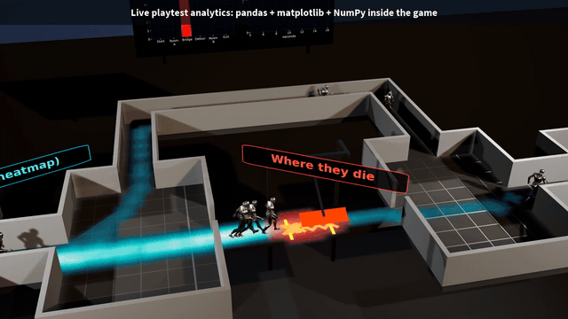

# UnrealPy examples

Four Unreal scenes use Python packages during gameplay. Run them in the editor or a packaged Windows game with [UnrealPy](https://unrealpy.canestudios.xyz/).

| Example | Python package | What it does |
|---|---|---|
| [Security camera](Python/examples/security_camera/README.md) | OpenCV | A camera in the level watches the room through OpenCV: motion detection, tracking, an alarm |
| [Enemies that learn](Python/examples/learning_enemies/README.md) | PyTorch | Drones trained by a small network while you play: within a minute they dodge |
| [Live playtest analytics](Python/examples/live_analytics/README.md) | pandas + matplotlib + NumPy | Autopiloted playtesters run a level; heatmaps and charts show where they walk and die |
| [GPU fluid](Python/examples/fluid/README.md) | NVIDIA Warp | A fluid simulated by Python GPU kernels, pushing mannequins around a tank |

| OpenCV | PyTorch |
|---|---|
|  |  |
| **pandas + matplotlib** | **NVIDIA Warp** |
|  |  |

[Watch the packaged examples](https://unrealpy.canestudios.xyz/docs/examples/packages/) or [play a full game written in Python](https://canestudios.github.io/unrealpy-freedoom/).

## Requirements

- Windows and Unreal Engine 5.8 with mannequin template content. The fluid scene also needs an NVIDIA GPU.
- [UnrealPy for UE 5.8](Plugins/README.md) and [uv](https://docs.astral.sh/uv/).

## Set up

1. Open `UnrealPyExamples.uproject` with UnrealPy installed. First start needs internet to set up Python. Close the editor when setup finishes.
2. In the project folder, install the dependency group for the scene you want. For the camera, run `uv sync --locked --group vision --group media`.

   | Example | Group | Packages |
   |---|---|---|
   | security_camera | `vision` | `opencv-python-headless` |
   | learning_enemies | `learning` | `torch` (the CPU build, from the PyTorch index) |
   | live_analytics | `analytics` | `pandas`, `matplotlib` |
   | fluid | `fluid` | `warp-lang` |

If you change `pyproject.toml` or `uv.lock`, run the group sync again.

For headless setup and packaging, [install the command from your copy of UnrealPy](https://unrealpy.canestudios.xyz/docs/reference/cli/#install-the-command). Run `unrealpy env` and `unrealpy stubs` in the project folder if you want to set it up without opening the editor.

The project's configuration does the rest: `Config/DefaultUnrealPy.ini` loads the examples' classes
(`+ClassPackages=examples`) and ships the fluid's kernels as source (Warp reads them); `Config/DefaultEngine.ini`
turns on Lumen and the mesh distance fields it traces; `Config/DefaultGame.ini` cooks the folders the examples
fill at their first run: Epic's mannequins, copied from the engine's own third-person template
(`Python/examples/mannequins.py`; the repository ships no Unreal assets), and the fluid's materials
(`Python/examples/fluid/assets.py`).

## Run an example

**Play it.** Copy the mannequins from the engine template, then launch the security camera in a game window. Adjust the engine path for your installation. Watch the guards and intruder move through the camera’s view.

```powershell
uv run --no-sync python -m examples.mannequins
$editor = "C:\Program Files\Epic Games\UE_5.8\Engine\Binaries\Win64\UnrealEditor.exe"
& $editor (Resolve-Path UnrealPyExamples.uproject).Path -game -windowed -UnrealPyRun=examples.security_camera.game:play -UnrealPyKeepAlive
```

For another scene, replace `security_camera` with its folder name and sync its dependency group. Before playing the fluid scene for the first time, run `unrealpy run --editor examples.fluid.assets:main` to create its materials.

**Record it.** Each example has one command that plays it in a headless editor (no window) and saves a clip and
a screenshot under `Saved/`, from the project folder:

    uv run --no-sync python Python/examples/security_camera/demo.py
    uv run --no-sync python Python/examples/learning_enemies/demo.py
    uv run --no-sync python Python/examples/live_analytics/demo.py
    uv run --no-sync python Python/examples/fluid/demo.py

and the same in a packaged Development build, after packaging with the example's group:

    unrealpy package --group vision
    uv run --no-sync python Python/examples/security_camera/demo.py --packaged

The recording scripts use the `media` group for title cards and download FFmpeg on demand. If the plugin is installed inside the project, they can also find its CLI there.

## Tests

The examples' engine-free parts (the rules, the summaries, the kernels on Warp's CPU device, the pictures)
have unit tests, which run on UnrealPy's engine-less fake of the `ue` module (from `Plugins/UnrealPy`, with the
type stubs the editor wrote at its first start, or `unrealpy stubs`):

    uv sync --group dev --group vision --group learning --group analytics --group fluid
    uv run --no-sync pytest

## Licences

Cane Studios’ example code and documentation use the [MIT License](LICENSE). UnrealPy, Unreal Engine, template assets and dependencies keep their own licences. [Contact Cane Studios](mailto:contact@canestudios.xyz).

| Package | Licence | Used by |
|---|---|---|
| NumPy | BSD-3-Clause | all |
| `opencv-python-headless` (OpenCV) | Apache-2.0 (the wheel bundles FFmpeg, LGPL-2.1) | security_camera |
| PyTorch (`torch`) | BSD-3-Clause | learning_enemies |
| pandas | BSD-3-Clause | live_analytics |
| matplotlib | matplotlib licence (PSF-style, permissive) | live_analytics, the demo scripts |
| NVIDIA Warp (`warp-lang`) | Apache-2.0 | fluid |
| `imageio-ffmpeg` (ffmpeg binary, demo scripts only) | BSD-2-Clause (wrapper); ffmpeg LGPL/GPL build | the demo scripts |
| UE5 mannequins (engine template content) | Unreal Engine EULA: usable in Unreal Engine projects; not redistributed here | all |
